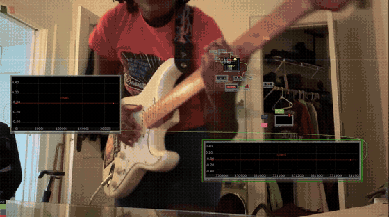
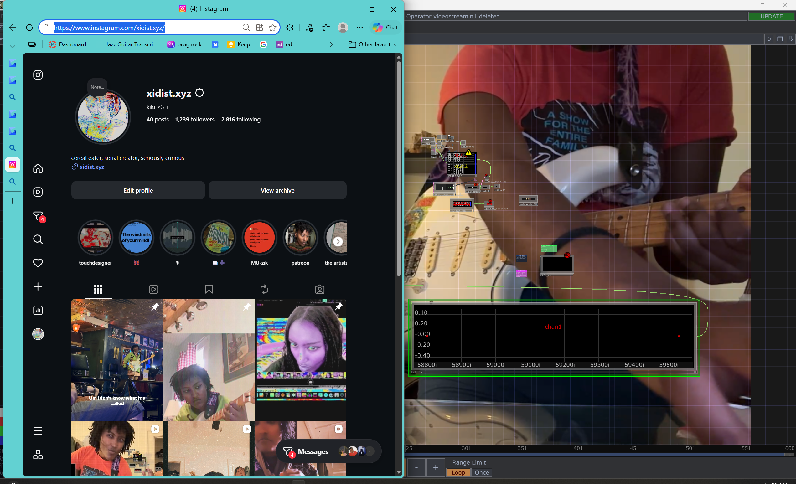
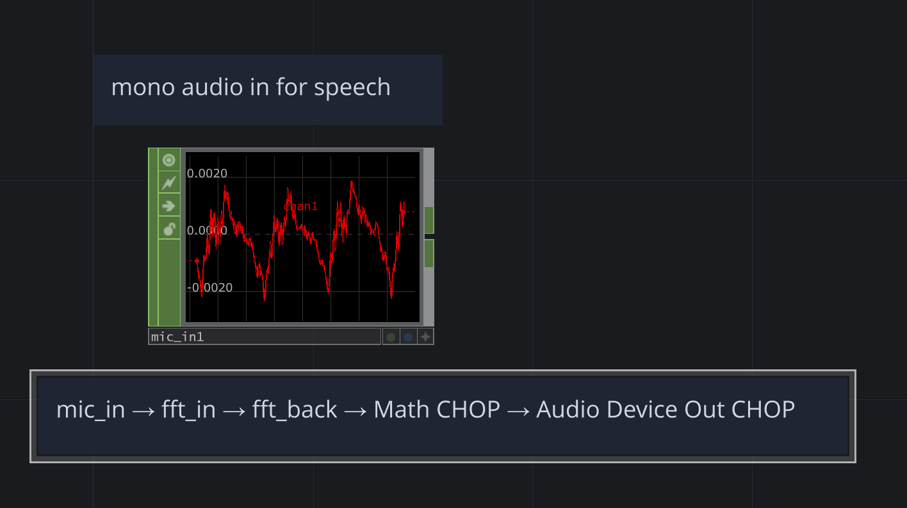
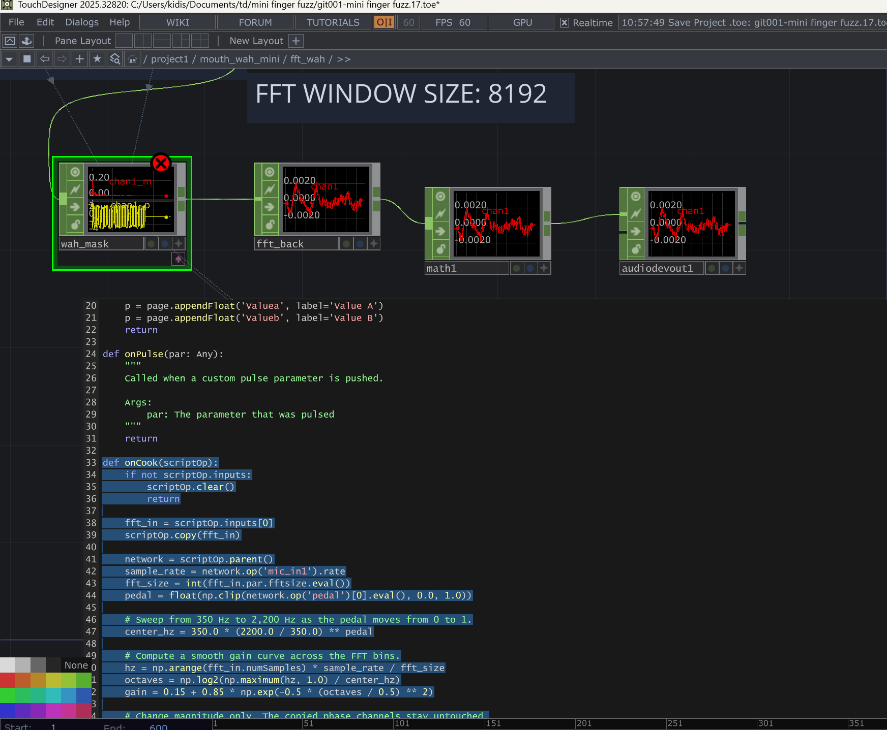
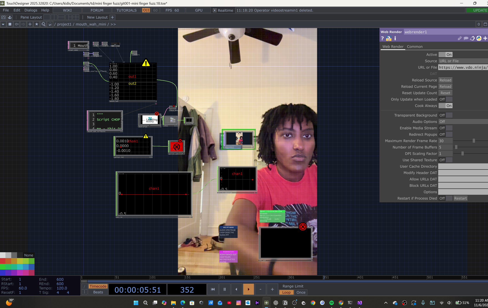
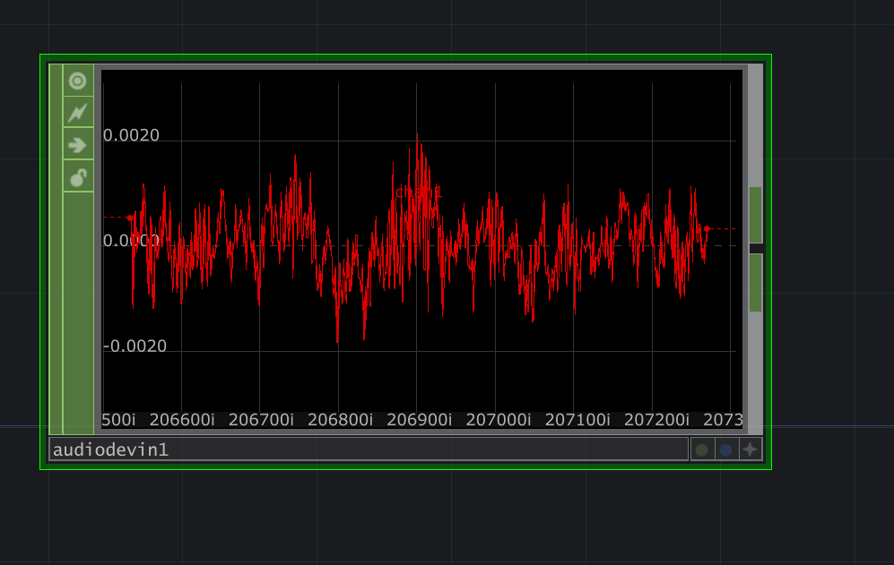
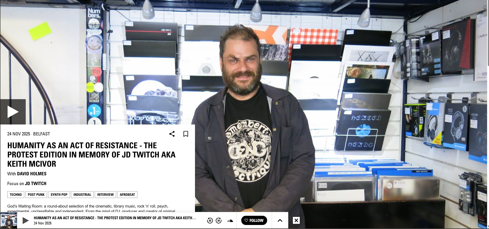
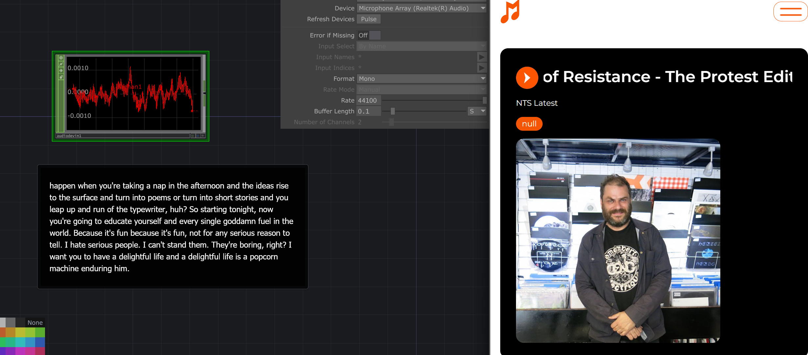

# Changelog

Progress notes for Finger Fuzz and its current Mouth Wah Mini prototype.

## 2026-11-06 — Audio spectrum and live captions

Added a live audio spectrum for the microphone used for speech captions.


### Live captions

See the OBS speech captions in the [live caption demo (.mov)](Movie/live-caption-demo.mov).

Twitch channel: [xidist](https://www.twitch.tv/xidist).



[Open the full Gyazo MP4 with audio](Movie/2026-11-06-gyazo-demo.mp4). The preview loops silently.

November 6 stream clip: [Watch on Twitch](https://www.twitch.tv/xidist/clip/SpeedySavagePelicanImGlitch-sberb_aqld4mX5q8) · [Download the MP4](Movie/2026-11-06-twitch-demo.mp4).

Instagram: [@xidist.xyz](https://www.instagram.com/xidist.xyz/).



### FFT wah prototype

#### Mono mic FFT round trip

The screenshot shows the raw mono speech input (`mic_in1`) and the baseline routing note. Use that signal as `mic_in` for the first playback test:

```text
mic_in → fft_in → fft_back → Math CHOP → Audio Device Out CHOP
```

Check the forward and inverse FFT with no wah mask first. Use the Math CHOP to lower the monitoring level, then insert `wah_mask` between `fft_in` and `fft_back` once the reconstructed voice sounds clean.



#### Parallel FFT paths and wah mask

Inside `/project1/mouth_wah_mini/fft_wah`, the mono mic input feeds `fft_in`. Its magnitude (`_m`) and phase (`_p`) channels feed two parallel paths:

```text
mic_in1 → fft_in ─┬─→ audiospect2          (unmasked reference path)
                  └─→ script1 → fft_back  (wah path)
```

- `script1` is the Script CHOP for the wah mask (`wah_mask` in the prototype instructions). Its `script1_callbacks` DAT should apply the pedal-dependent gain to magnitude bins and preserve phase.
- The network annotation shows an 8,192-sample FFT window. The callback reads the actual FFT Size from `fft_in`; 2,048 samples was the earlier prototype starting point.
- The screenshot still shows `fft_back` in **Time to Magnitude and Phase** mode. Switch it to **Magnitude and Phase to Time**, then route its waveform through a Math CHOP for level and into Audio Device Out CHOP. Verify the unmasked reference before listening to the wah path.

#### Prototype steps

Prototype workflow for testing the wah with a mono microphone in TouchDesigner before connecting the guitar:

1. Inside a Base COMP named `fft_wah`, route `mic_in` through an Audio Spectrum CHOP in **Time to Magnitude and Phase** mode with a 2,048-sample FFT.
2. Verify the unmodified round trip first: send magnitude and phase into a second Audio Spectrum CHOP in **Magnitude and Phase to Time** mode. Monitor the result through Audio Device Out CHOP at low gain with headphones.
3. Insert a Script CHOP between the transforms. Map a manual pedal from 0 to 1 onto a logarithmic sweep from 350 Hz to 2.2 kHz: `center_hz = 350 * (2200 / 350) ** pedal`. Multiply only the magnitude bins by a smooth peak centered at that frequency, leaving phase unchanged. For a bin frequency `f`, use `gain = 0.15 + 0.85 * exp(-0.5 * (log2(max(f, 1) / center_hz) / 0.5) ** 2)`.
4. Compare the dry and processed audio with separate Audio Spectrum CHOPs in **Visualization** mode. Send the processed spectrum through CHOP to TOP for the stream visual. Keep playback on the reconstructed audio CHOP path.
5. Sweep the pedal while making a steady “shhh” sound. Use Audio File Out CHOP to record a WAV if needed. Once the manual sweep is clean, switch the input to guitar and drive the pedal with calibrated MediaPipe `jawOpen`.

#### Manual pedal control

Add a Constant CHOP named `pedal` inside `fft_wah` and set its first value to `0.5`. Leave it unwired: the `wah_mask` Script CHOP reads the first channel by name.

```text
Audio Device In → fft_wah input
Inside fft_wah: mic_in1 → fft_in → wah_mask → fft_back → math1 → audiodevout1
                                  ↑
                      pedal (Python lookup; no wire)
```

Sweep the Constant from `0` to `1` while making a steady “shhh” sound. The script clamps the control to that range and sweeps the center frequency from 350 Hz to 2,200 Hz. The reconstructed audio remains centered at zero, with positive and negative samples. Once the manual sweep is verified, feed a calibrated MediaPipe `jawOpen` channel into the pedal control.

#### FFT wah callback

The current patch wires `fft_in → wah_mask → fft_back → math1 → audiodevout1`. The callback reads the sample rate from `mic_in1` and the FFT size from `fft_in`, so it follows the configured window size.



Inside `fft_wah`, add a Constant CHOP named `pedal` and start its first value at `0.5`. Paste this into the callbacks DAT for `wah_mask`:

```text
mic_in → fft_in → wah_mask → fft_back → Math CHOP → Audio Device Out CHOP
```

```python
import numpy as np


def onCook(scriptOp):
    if not scriptOp.inputs:
        scriptOp.clear()
        return

    fft_in = scriptOp.inputs[0]
    scriptOp.copy(fft_in)  # Preserve channel names, sample rate, and phase.

    network = scriptOp.parent()
    sample_rate = network.op('mic_in1').rate
    fft_size = int(fft_in.par.fftsize.eval())
    pedal = float(np.clip(network.op('pedal')[0].eval(), 0.0, 1.0))
    center_hz = 350.0 * (2200.0 / 350.0) ** pedal
    hz = np.arange(fft_in.numSamples) * sample_rate / fft_size
    octaves = np.log2(np.maximum(hz, 1.0) / center_hz)
    gain = 0.15 + 0.85 * np.exp(-0.5 * (octaves / 0.5) ** 2)

    for channel in fft_in.chans('*_m'):
        scriptOp[channel.name].vals = (
            np.asarray(channel.vals) * gain
        ).tolist()
```

`onCook()` writes its output to `scriptOp` and returns `None`. If you keep `onGetCookLevel()`, return `CookLevel.AUTOMATIC` there.

The screenshot shows a waveform downstream of `fft_back` and an error badge on `wah_mask`. Check that error and confirm the pedal audibly changes the output. Guitar testing is still pending.

### VDO.Ninja camera preview

TouchDesigner Web Render TOP displaying the VDO.Ninja camera feed in the Mouth Wah Mini network.



### kiki was harmonizing and singing with it

**1:07 PM CST**

Kiki sang and harmonized along with David Holmes' NTS set. [Listen to the November 24, 2025 episode on NTS](https://www.nts.live/shows/david-holmes/episodes/david-holmes-24th-november-2025).







## 2026-11-05 — Mouth Wah Mini prototype

### Added

- A Python builder that creates `/project1/mouth_wah_mini` in TouchDesigner.
- MediaPipe `jawOpen` control with adjustable closed-mouth and open-mouth calibration.
- A resonant wah sweep from 350 Hz to 2.2 kHz, with a 45 ms control-smoothing time constant.
- A Script CHOP guitar-processing path with persistent filter state and duplicated mono output for stereo playback.
- An OpenCV preview with a jaw score, target-frequency readout, and pedal-position meter.
- Manual Pedal control for testing the effect before connecting face tracking.
- Optional face-presence input to fade the effect back to dry when tracking is lost.
- Setup instructions for webcam tracking and Vetco USB-C guitar input and monitoring.
- A README with a Mermaid diagram of the vision, control, and guitar-audio paths.

### Changed

- Moved the interaction from a thumb–index pinch controlling fuzz to jaw opening controlling wah, freeing both hands for guitar playing.

### Repository progress

- Published the project to the public `xidist/mini-finger-fuzz` repository.
- Configured Git LFS for `.toe` project files and uploaded project snapshots and backups.
- Added `.gitkeep` placeholders to preserve the Audio, Chan, Geo, Image, and Movie folders when cloning.

### Validation and current status

- Ran the builder in TouchDesigner on Windows after correcting the quoted file path in Textport.
- Development environment reported as TouchDesigner 2025.32820 with Python 3.11.10.
- Checked jaw mapping, manual control, frequency response, stereo output, and the dry fade using simulated inputs.
- Live webcam calibration, OpenCV preview rendering, Vetco routing, and end-to-end playing latency still need verification on the laptop.

### Next session

- Confirm the `jawOpen` channel responds in the MediaPipe face-tracking blend-shape CHOP.
- Connect Jaw CHOP and Camera TOP, then calibrate a comfortable mouth movement.
- Select the guitar input and playback devices and test the sweep while playing.
- Save the configured `.toe` and capture a short demonstration.

If the tracker sends zero jaw scores on face loss and no face-presence input is connected, the wah settles at the closed-mouth end of the sweep.
