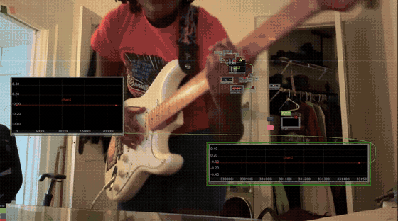
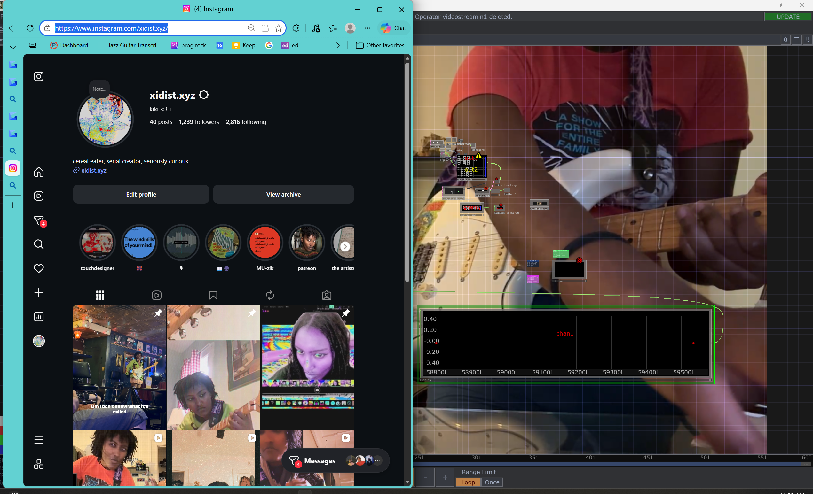
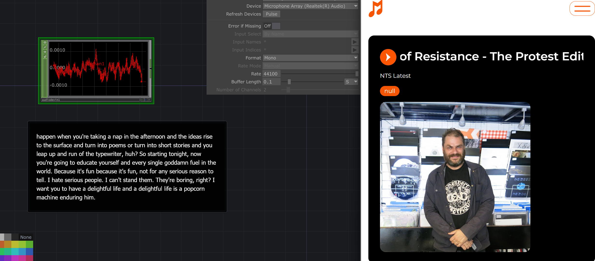
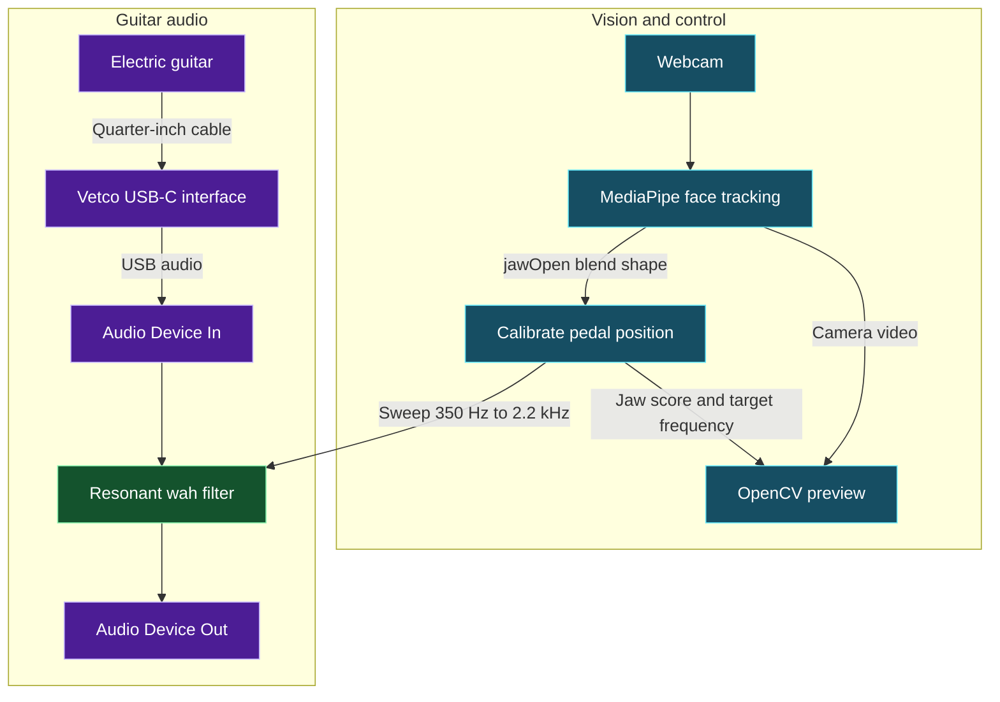

# Mouth Wah Mini

**A webcam-controlled guitar wah built in TouchDesigner.**

Open your mouth to sweep the wah toward a brighter sound. Close it to bring the sweep back down. The webcam acts like an expression pedal, leaving both hands free to play.

This project grew out of Finger Fuzz, a prototype that used a thumb–index pinch to control a guitar effect. Mouth Wah Mini keeps the camera-driven interaction and moves the control to your jaw.

## Fuzz Wah in Perform Mode

Open the [More Drive TouchDesigner preset](Fuzz%20Wah%20-%20Voodoo%20Child%20-%20More%20Drive.toe) and enter Perform Mode. The patch runs the mouth-controlled wah into fuzz, with adjustable Overdrive. The spectrum shows the input in cyan and the processed output in orange.

[Download the Fuzz Wah demo](Movie/2026-11-11-fuzz-wah-demo.mp4)

- **Play guitar.** Select your guitar interface as input and your laptop speakers or headphones as output. Open and close your mouth to sweep the wah.
- **Adjust while fretting.** Keep your left hand on the neck. Raise your open right palm, wait for **Raised hand active**, then pinch and slide sideways. Thumb + index changes **Sweep Range**, thumb + middle changes **Resonance**, and thumb + ring changes **Output Wah Volume**. Lower your hand to hold the setting and resume picking.
- **Use two hands.** Raise both palms to adjust two different sliders at once. Raise both index fingers and vary the distance between them to adjust **Overdrive**.
- **Record and play back speech.** Open the [Speech Capture preset](Fuzz%20Wah%20-%20Speech%20Capture.toe), enable **Mic In**, and select **Record Speech**. The speakers stay muted during recording. Select **Stop Recording** and then **Play Take** to hear the processed take with the microphone off.

## Jaw-to-wah starter kit

The [starter kit](jaw-to-wah/README.md) includes a standalone Python controller, eight automated tests, and integration notes for MediaPipe and TouchDesigner. The tests cover calibration, clamping, smoothing, tracking loss and recovery, and invalid inputs and timestamps. The webcam, OSC, and audio checks are listed separately for local validation.

## Stream demo



[Open the full Gyazo MP4 with audio](Movie/2026-11-06-gyazo-demo.mp4). The preview loops silently.

[Watch the Twitch clip](https://www.twitch.tv/xidist/clip/SpeedySavagePelicanImGlitch-sberb_aqld4mX5q8) · [Download the MP4](Movie/2026-11-06-twitch-demo.mp4)

Instagram: [@xidist.xyz](https://www.instagram.com/xidist.xyz/).



### Live captions



The on-screen captions transcribe audio from David Holmes' November 24, 2025 NTS broadcast, [Humanity as an Act of Resistance — The Protest Edition on SoundCloud](https://soundcloud.com/user-202286394-991268468/humanity-as-an-act-of).

## Signal flow



MediaPipe estimates jaw opening. TouchDesigner maps the score to a pedal position and smooths the sweep with a 45 ms time constant. A state-variable band-pass filter processes the guitar in a Script CHOP. OpenCV draws the jaw score, target frequency, and pedal meter over the camera feed.

## Run it on Windows

You'll need TouchDesigner, a webcam, the [MediaPipe TouchDesigner plugin](https://github.com/torinmb/mediapipe-touchdesigner), and a guitar connected to the Vetco interface or another audio interface. The preview meter uses OpenCV (`cv2`). The audio effect works independently of the preview.

If the saved project already contains `mouth_wah_mini`, open it and go straight to step 3. To rebuild the patch from source, use the [Python builder](./Mouth_Wah_Mini_Builder.py).

1. **Start the tracker.** Open the MediaPipe demo `.toe`. Select your webcam on the `MediaPipe` component, enable **Face Tracking**, and enable **Blend Shapes** if your version has that option. Check that `jawOpen` moves in the `face_tracking` blend-shape CHOP.
2. **Build the patch.** Open **Dialogs → Textport** and run this as one line. Replace the path with the location of your copy of the builder.

   ```python
   exec(compile(open(r'C:/path/to/Mouth_Wah_Mini_Builder.py', encoding='utf-8').read(), 'Mouth_Wah_Mini_Builder.py', 'exec'))
   ```

3. **Connect and calibrate.** On the **Mouth Wah** page of `/project1/mouth_wah_mini`, set **Jaw CHOP** to the blend-shape CHOP and **Camera TOP** to the MediaPipe video output. View `OUT_VIDEO` and set **Jaw Closed** and **Jaw Open** to the scores you can comfortably reach while playing. The starting values are 0.04 and 0.55.
4. **Route the guitar.** In `guitar_in`, select the Vetco recording device. If needed, set **Guitar Channel** to the active input index, starting at zero. Select your playback device in `speakers`, lower **Volume**, and switch **Active** on. Start with wired playback. Save the configured patch as a new `.toe`.

## Try the controls

| What you want to test | What to do |
| --- | --- |
| Hear the full sweep | Strum a sustained chord, then slowly open and close your mouth. |
| Test audio before connecting the camera | Leave **Jaw CHOP** empty and move **Manual Pedal** from 0 to 1. |
| Fade back to dry when you leave the frame | Connect a 0/1 tracking signal to **Face Present CHOP** and name its channel. If the tracker sends zero jaw scores and no presence signal is wired, the wah stays at the dark end. |
| Diagnose a missing meter | Run `import cv2; print(cv2.__version__)` in Textport. If OpenCV is unavailable, the preview passes through the camera image. |

The jaw mapping, filter sweep, stereo output, and dry fade were checked with simulated inputs. Live tracking, device routing, and playback latency depend on the local TouchDesigner setup.

## Get the project files

The large TouchDesigner `.toe` files use [Git LFS](https://docs.github.com/en/repositories/working-with-files/managing-large-files/about-git-large-file-storage). After cloning, run `git lfs pull` if you need to fetch the project binaries.
